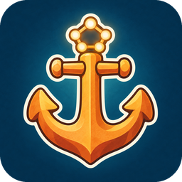

<p align="center">
  
</p>

<h1 align="center">Anchored</h1>

<p align="center">
  One memory for every coding agent on your machine.
</p>

<p align="center">
  <a href="https://github.com/jholhewres/anchored/actions/workflows/ci.yml"></a>
  <a href="https://github.com/jholhewres/anchored/releases/latest"></a>
  <a href="LICENSE"></a>
  
</p>

<p align="center">
  <b>English</b> &middot; <a href="README.pt-BR.md">Português</a>
</p>

---

## What it is

A local memory your coding agents share. Claude Code, Cursor, Codex,
OpenCode, Gemini CLI and any other MCP tool read and write the same store on
your machine, so a decision made in one session is still there in the next,
whichever tool you open. One binary, no account, and nothing leaves the
machine unless you add a remote.

## What it does

- **One store for every tool**: the MCP server and the CLI are one binary, and `anchored init` wires it into more than fifteen hosts.
- **Search that finds what you meant**: BM25, local multilingual embeddings, entities and a knowledge graph, ranked for the project you are in; about 0.2 s on 85k memories.
- **Context at the start of each session**: who you are, the project, recent decisions, under a token budget, with the savings counted (`anchored stats --tokens`).
- **A knowledge graph** of what uses, owns and depends on what, per project.
- **Memory that stays clean**: background curation demotes low-signal entries without deleting them; `dream` proposes merges and flags contradictions for you to review.
- **Context-window tools**: run code, index long output and fetched docs, and search them without flooding the model.
- **Remotes for teams**: share project memory through a self-hosted [Anchored OSS](https://github.com/jholhewres/anchored_oss) instance, personal and company side by side, with each repository routed to its own.
- **Private by default**: only project knowledge that passes the safety filter is ever synced; secrets, local paths and your personal scope stay home.
- **A local dashboard** for memories, the graph, tasks, token savings and which tools are connected.

## Install

```sh
curl -fsSL https://raw.githubusercontent.com/jholhewres/anchored/main/install/install.sh | bash
```

Linux, macOS, and Windows under Git Bash. The first run downloads the local
embedding model (~470 MB); `anchored self-update` keeps the binary current.
From source, updates and platform notes: [docs/install.md](docs/install.md).

## Connect your tools

Claude Code, with the plugin (MCP, slash commands, hooks and skill in one go):

```text
/plugin marketplace add jholhewres/anchored
/plugin install anchored@anchored
```

Everything else:

```sh
anchored init                  # detects the tools you have installed
anchored init --tool cursor    # or one at a time
```

Every host, file and hook: [docs/setup.md](docs/setup.md).

## Links

- [What it does, in detail](docs/features.md)
- [CLI and MCP tools](docs/cli.md)
- [Remotes and team sync](docs/remotes.md) · [Anchored OSS](https://github.com/jholhewres/anchored_oss)
- [Design](docs/design.md) · [Architecture](docs/architecture.md) · [Embedding model](docs/embedding-model.md)
- [Import sources](docs/import-sources.md) · [MCP protocol](docs/mcp-protocol.md) · [Glossary](GLOSSARY.md)
- [Changelog](CHANGELOG.md) · [Contributing](CONTRIBUTING.md)
- [Licence: MIT](LICENSE)
